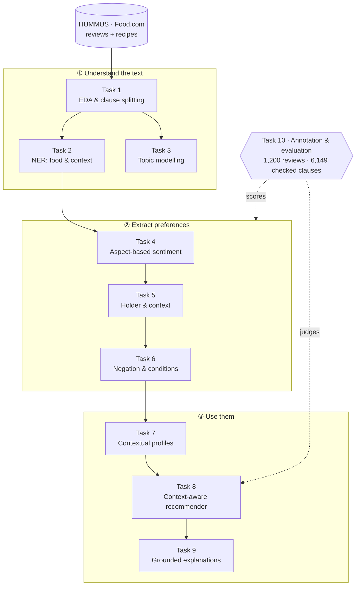

<div align="center">

# 🥗 Contextual Preference Extraction from Food Reviews

**Who likes what, and when?**<br/>
An NLP pipeline that turns Food.com reviews into *holder-aware* and *context-aware* preference tuples,<br/>
then uses them for recipe recommendation and evidence-grounded explanations.

[](https://www.python.org/)
[](https://spacy.io/)
[](https://huggingface.co/docs/transformers)
[](https://www.kaggle.com/)
[](https://doi.org/10.1145/3604915.3609491)
[](#-the-ten-tasks)

[Overview](#-overview) · [Pipeline](#-pipeline) · [Key results](#-key-results) · [Quickstart](#-quickstart) · [Layout](#-repository-layout) · [Task notes](docs/TASKS.md) · [Credits](#-credits)

</div>

> [!NOTE]
> This project was created by **[Raiyan Ahmed (@notraiyan)](https://github.com/notraiyan)** in [notraiyan/hummus-dataset](https://github.com/notraiyan/hummus-dataset). This repository is a reorganised copy kept by [@Imran5002](https://github.com/Imran5002), with the original commit history preserved. The research, code and results are the original author's.

---

## 🔎 Overview

A review rarely speaks for one person in one situation. Recommenders that treat every opinion as the reviewer's own, true at all times, build the wrong profile.

> *"I love spicy food, but this was too hot for my children. Great for weekend dinners, but too time-consuming for weekdays."*

| Holder | Aspect | Sentiment | Context |
|:--|:--|:--:|:--|
| reviewer | spicy food | 🟢 positive | general |
| **children** | spiciness | 🔴 negative | general |
| reviewer | suitability | 🟢 positive | **weekend** |
| reviewer | preparation time | 🔴 negative | **weekdays** |

Each preference is stored as **(holder, aspect, sentiment, context, evidence span)**, so the children's dislike never becomes the reviewer's, and "too slow on weekdays" never becomes "too slow".

**Research question:** does preserving the *holder* and the *condition* prevent wrong generalisations in user profiles, and improve recommendation and explanation accuracy?

## 🧭 Pipeline



### 📋 The ten tasks

| # | Task | Approach | Status |
|:-:|:--|:--|:--:|
| 1 | [EDA & text preparation](docs/TASKS.md#task-1-details) | HTML cleaning, NLTK sentence and clause splitting before contrast words | ✅ |
| 2 | [NER for food & context](docs/TASKS.md#task-2-details) | spaCy dictionary matcher vs a weakly supervised spaCy model vs `en_core_web_sm` | ✅ pilot |
| 3 | [Topic modelling](docs/TASKS.md#task-3-details) | LDA vs NMF vs BERTopic on an "experience" vocabulary | ✅ |
| 4 | [Aspect-based sentiment](docs/TASKS.md#task-4-details) | Cue lexicon + `deberta-v3-base-absa`, per clause, 7 aspects | ✅ pilot |
| 5 | [Holder & relation extraction](docs/TASKS.md#task-5-details) | Dependency rules vs Qwen3-4B with a fixed JSON schema | ✅ pilot |
| 6 | [Negation & conditions](docs/TASKS.md#task-6-details) | Negation scope, *if*-conditions and exceptions; 32-sentence challenge set | ✅ pilot |
| 7 | [Contextual user profiles](docs/TASKS.md#task-7-details) | General vs context profiles, stable vs tentative, with evidence | ✅ pilot |
| 8 | [Context-aware recommendation](docs/TASKS.md#task-8-details) | Content + collaborative filtering + contextual profile, chronological test | ✅ pilot |
| 9 | [Grounded explanations](docs/TASKS.md#task-9-details) | Extractive / template vs LLM-generated, with automatic attribution checks | ✅ pilot |
| 10 | [Annotation & evaluation](docs/TASKS.md#task-10-details) | Checked gold labels, P/R/F1, tuple F1, LLM-judged NDCG@10 | ✅ |

## 📊 Key results

*Kaggle run (GPU). Full numbers and caveats in the [status table](docs/TASKS.md#status-table).*

**Does keeping holders and conditions help?**

| Where | Without holders & contexts | With them |
|:--|:--|:--|
| 👤 **Profiles** (Task 7) | 13 stable general preferences that members' own opinions don't support | not claimed |
| 💬 **Explanations** (Task 9) | 12% of cited opinions credited to the wrong person | 0% |
| 🍽️ **Recommendation** (Task 10, 10 requests) | NDCG@10 0.732 | NDCG@10 0.773 *(suggestive only)* |

**Component quality** on 6,149 checked clauses from 1,200 real reviews:

| Component | Result |
|:--|:--|
| Preference tuples (aspect, sentiment, holder, context, condition) | P 0.73 · R 0.54 · **F1 0.62** |
| Aspect detection | P 0.89 · R 0.65 · F1 0.75 |
| NER, model trained on checked labels | **F1 0.746**, vs 0.671 dictionary and 0.652 weakly supervised |
| Topics | NMF most distinct (diversity 0.94) and rated most interpretable (2.67 / 3) |
| Chronological recommendation (popularity-matched) | NDCG@10: combined **0.18** · CF 0.17 · popularity 0.14 · random ≈ 0.09 |

> [!IMPORTANT]
> **Honest limits.** One annotator checked an LLM pre-annotation rather than labelling from scratch, so there is no inter-annotator agreement. Contextual matching was judged by an LLM (Qwen3-14B) on only 10 requests, with no significance test, and the content score alone ranked highest (0.849). The small hand-written test sets favour the systems; every score drops on real reviews.

## 🚀 Quickstart

The pipeline is a **Kaggle notebook split into files**: each file in [`pipeline/`](pipeline) is one notebook cell. The cells share variables, so they run in order in the same session, and some start with `!pip install`, so they are not standalone scripts.

### On Kaggle (recommended)

1. Create a new notebook. Under **Settings**, turn **Internet on** and set the accelerator to **GPU T4 x2**.
2. Run everything from one cell:

```python
!git clone -q https://github.com/Imran5002/contextual-food-preferences.git
%cd contextual-food-preferences

STEPS = ["load-dataset"] + [f"task-{i}" for i in range(1, 11)]
for step in STEPS:
    print(f"\n{'=' * 25} {step} {'=' * 25}")
    get_ipython().run_cell(open(f"pipeline/{step}.py").read()).raise_error()  # stops at the first error
```

Or paste each file into its own cell, in the same order. Outputs (CSVs, the NER model) are written to `/kaggle/working`. Task 10 reads the gold labels from [`annotations/`](annotations), or from an attached Kaggle dataset that contains `annotation_checked.csv`.

### Locally

```bash
git clone https://github.com/Imran5002/contextual-food-preferences.git
cd contextual-food-preferences
pip install -r requirements.txt
python -m spacy download en_core_web_sm
```

Then open Jupyter in the repository folder and run the same loop. `kagglehub` may need [Kaggle credentials](https://github.com/Kaggle/kagglehub), the LLM steps (Tasks 5, 9, 10) need a GPU to be practical, and Task 3 writes to `/kaggle/working` (create it, or change `OUT_DIR` in `task-3.py`).

## 📁 Repository layout

```
contextual-food-preferences/
├── pipeline/                         # one notebook cell per file, run in order
│   ├── load-dataset.py               # loads the three HUMMUS tables with kagglehub
│   └── task-1.py … task-10.py        # Tasks 1–10
├── annotations/
│   ├── annotation_checked.csv        # gold labels: 6,149 clauses, all checked (Task 10)
│   ├── annotation_checked_fixed.csv  # a later copy with 6 corrected cells
│   └── topic_ratings_A.csv           # the author's interpretability ratings of Task 3's topics
├── docs/
│   ├── TASKS.md                      # design notes and findings for every task
│   ├── ANNOTATION.md                 # annotation guidelines and decisions
│   └── LITERATURE.md                 # related work and novelty argument
└── requirements.txt
```

## 🧾 Dataset

[**HUMMUS**](https://doi.org/10.1145/3604915.3609491) (Bölz et al., RecSys 2023) links Food.com recipes, ratings and review texts with nutrition and healthiness scores. It is loaded from Kaggle (`raiyanahmed/hummus`) with `kagglehub`:

- `pp_reviews.csv`: review text, rating, `last_modified_date`, member and recipe ids
- `pp_recipes.csv`: duration, ingredients, tags, nutrition and healthiness scores
- `pp_members.csv`: member metadata

<details>
<summary><b>Caveats that affect the analysis</b></summary>

- Recipe authorship appears as pseudo-reviews with rating `6` and no text.
- Reviews without a rating are set to `2.5`; only ratings 1–5 are real stars.
- There is no submission date, and an edit moves `last_modified_date` later, so a chronological split is approximate.
- Food.com data is for educational and scientific use only.

</details>

## 🙏 Credits

- **[Raiyan Ahmed (@notraiyan)](https://github.com/notraiyan)**: author of the project, code, annotations and results ([original repository](https://github.com/notraiyan/hummus-dataset)).
- **[@zerintasnim800-bot](https://github.com/zerintasnim800-bot)**: contributed `annotation_checked_fixed.csv`.
- **Dataset:** Bölz, F., et al. (2023). *HUMMUS: A linked, healthiness-aware, user-centered and argument-enabling recipe data set for recommendation.* RecSys 2023. [doi:10.1145/3604915.3609491](https://doi.org/10.1145/3604915.3609491)
- **Models:** [`yangheng/deberta-v3-base-absa-v1.1`](https://huggingface.co/yangheng/deberta-v3-base-absa-v1.1), [`Qwen/Qwen3-4B-Instruct-2507`](https://huggingface.co/Qwen/Qwen3-4B-Instruct-2507) and Qwen3-14B (Apache-2.0), spaCy `en_core_web_sm`, MiniLM sentence embeddings.

The original repository has no license file, so all rights remain with the original author.
